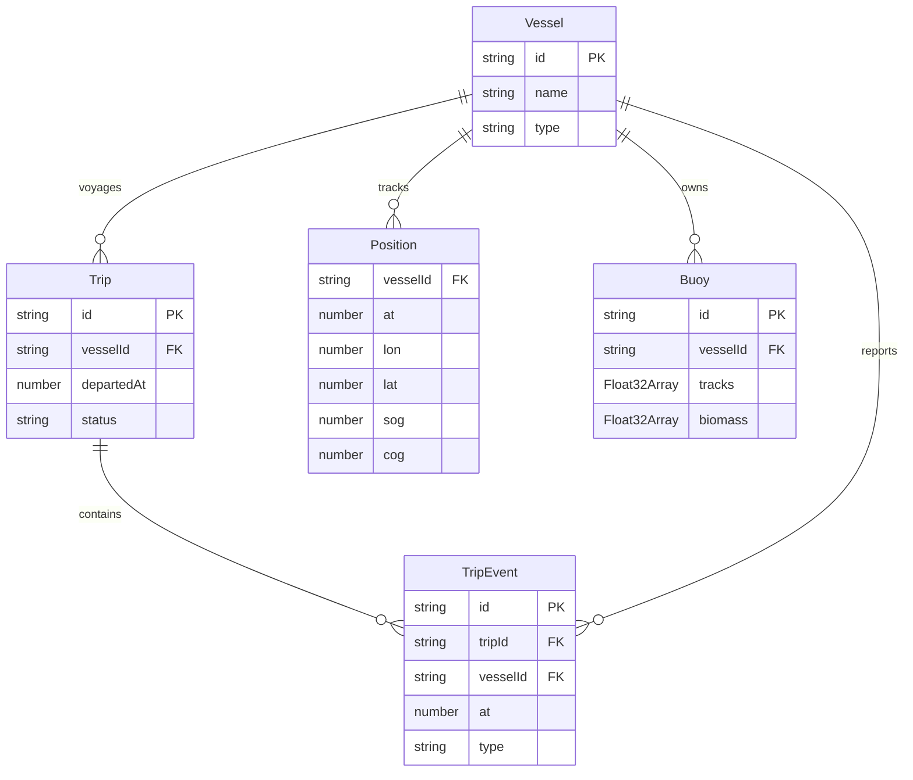
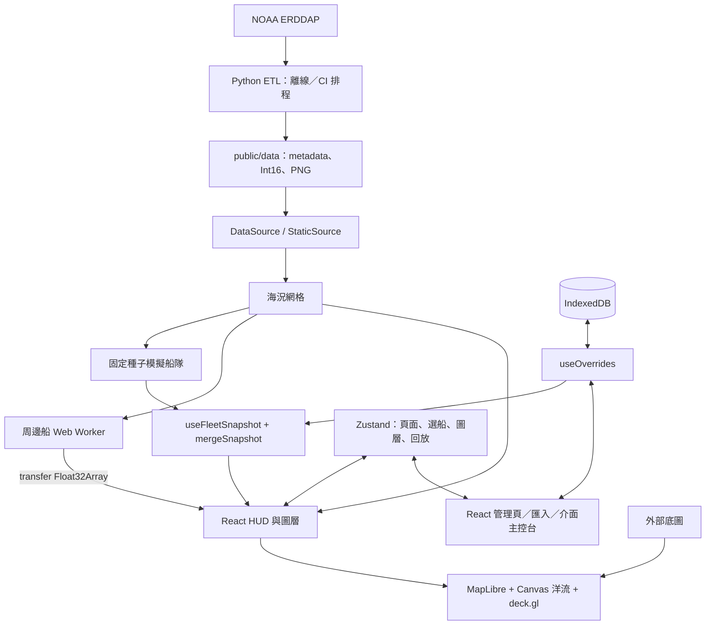
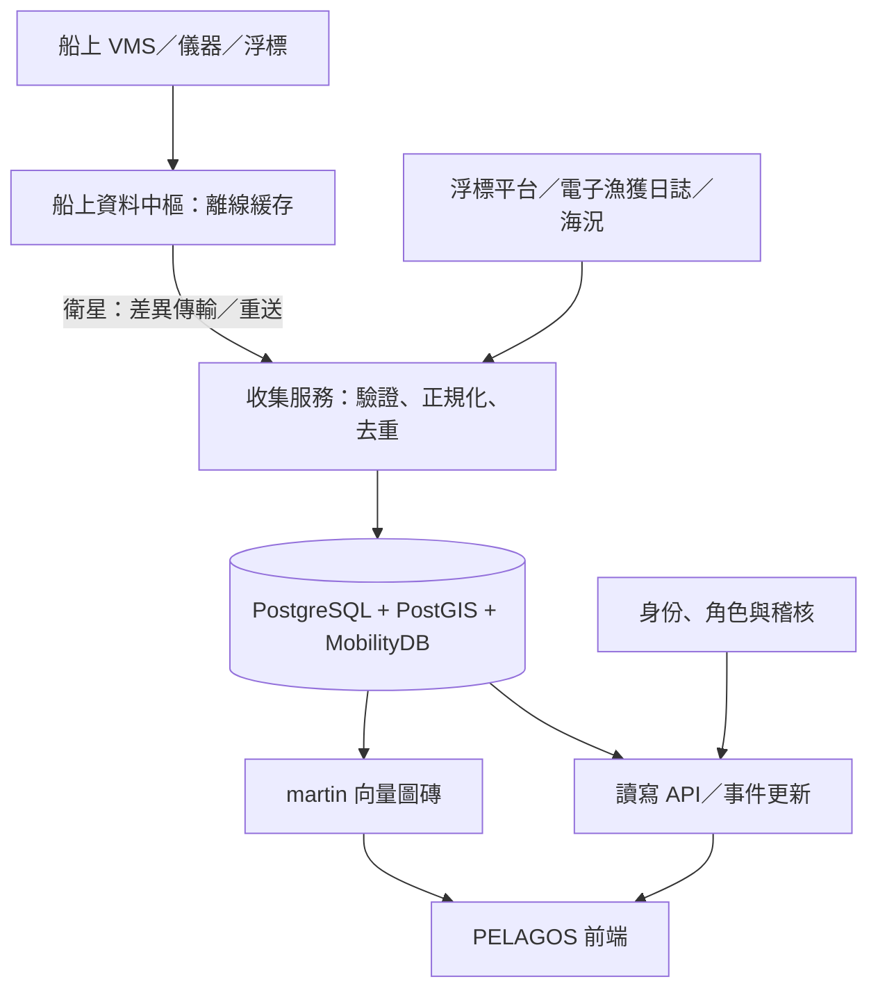

# PELAGOS — 遠洋船隊管理展示

以虛構的「藍潮漁業」展示船隊戰情與管理流程：地圖選船、航次與事件、主檔編輯、警示處理及資料匯入。規格以 [PRD §15](docs/PRD.md) 與 [TECH_SPEC §19（全球版 §19.5）](docs/TECH_SPEC.md) 為準，進度見 [TASKS.md](TASKS.md)。

海況來自公開資料；船舶、航次、漁獲、浮標與介面訊息都是模擬。本案沒有正式後端、登入權限或多人同步。

## 本機執行

使用 Node.js 22（與 CI 一致）及 npm。已有 public/data，不必先跑 ETL。

```bash
npm ci
npm run dev
# http://localhost:5173/pelagos/

npm run verify
# 資料檔存在檢查 → TypeScript → Vitest → production build

./scripts/preview.sh
# http://localhost:4173/pelagos/，背景執行；日誌 /tmp/pelagos-preview.log
node scripts/shot.mjs http://localhost:4173/pelagos/ /tmp/pelagos.png 11000
```

截圖需本機 Playwright 快取的 Chromium，見 [shot.mjs](scripts/shot.mjs)。產物在 dist/，子路徑為 /pelagos/。外部底圖仍需網路；完整離線與自動降級尚未完成。

V04 介面更新採深藍工作區與青綠重點色，統一六頁導覽、表格與詳情面板；管理頁隱藏地圖但保留相機。Ctrl／⌘ K 可搜尋船舶，方向鍵選結果、Enter 定位、Escape 關閉選單。地圖、船舶主檔與航次共用選船狀態；航次補登按需展開，輸入錯誤與完成狀態有明確回饋。

本機 preview 啟動後，可執行 `node scripts/ux-check.mjs` 做瀏覽器互動回歸。腳本使用獨立瀏覽器 context，驗證搜尋、跨頁選船、事件補登、主檔保存、警示、圖層、回放及 1600／1280／1024 桌面版面；截圖與結果預設寫入 `/tmp/pelagos-ux/`。不會修改使用者平常瀏覽器的資料。

## 已實作流程

| 模組 | 展示內容 |
|---|---|
| 戰情地圖 | 全球海況、36 艘自家船、24 小時航跡、選船詳情與航次事件、按需回放與圖層開關 |
| 船舶／航次 | 主檔搜尋篩選排序與編輯、每日漁獲、手動新增事件、航次摘要 |
| 浮標／警示 | 魚量排序與定位、規則推導警示、標記已處理 |
| 資料串接 | CSV／GeoJSON 匯入與欄位對應；VMS NAF、兩種浮標格式、簡化 FLUX XML 訊息解析 |
| 壓力測試 | 周邊模擬點數 1／5／10 萬與 FPS HUD，不代表實際管理船隊規模 |

介面主控台產生模擬報文並刻意混入錯誤。電子漁獲日誌可將解析結果寫入下網事件；簡化 FLUX 並非完整標準實作或相容性認證。

主檔覆寫、新增事件、匯入圖層與警示處理狀態存於同一瀏覽器 origin 的 IndexedDB（pelagos-overrides-v1），不會上傳；清除網站資料會移除紀錄。

## 資料模型

核心是「船 → 航次 → 事件」：船是主檔，航次界定一次出航，事件記錄作業歷程；船位另存時間序列。實際型別見 [types.ts](src/data/types.ts)。



這是邏輯關聯圖，demo 沒有資料庫外鍵約束。時間為 UTC 毫秒，經度為 0–360°，速度為節、航向為度。浮標以每小時座標及同步魚量陣列表示過去 24 小時。航次摘要保存天數、下網次數、漁獲、油量及浮標數；新增下網事件由 mergeSnapshot 累加次數與漁獲。

## 現行架構（已實作）



[DataSource](src/data/DataSource.ts) 提供 loadOcean() 與 loadFleet()；StaticSource 解碼海況並呼叫固定種子模擬。新增事件在 useFleetSnapshot 合併，主檔覆寫由管理畫面使用。來源與呈現分開，方便換 API；正式寫入、訂閱更新與錯誤處理仍需另行設計。

## 正式產品架構（提案，尚未實作）



船上中樞可評估 Signal K 類設計；岸上將供應商格式映射為共同模型，電子漁獲日誌再評估完整 FLUX 交換。正式化需補授權、稽核、訊息冪等與補送、來源時間與品質標記、備份監控。圖磚承擔大範圍空間資料，API 提供業務讀寫；不能僅換網址就完成產品化。

## 技術決策與取捨

| 決策 | 選擇與理由 | 取捨／邊界 |
|---|---|---|
| 地圖 | MapLibre 負責底圖、相機、地名；deck.gl 批次畫船舶、航跡與浮標 | 引擎開源不等於外部圖資沒有使用限制 |
| 疊層 | 非 interleaved MapboxOverlay，洋流 Canvas 放在兩個 WebGL 畫布間 | 易控制順序，但不共用深度緩衝；海溫與遮罩陸地放在 MapLibre 內 |
| 洋流 | Canvas 粒子取樣流場並留下拖尾 | 實作直接；CPU 與軟體繪圖會限制效能 |
| 大量船位 | Worker 計算周邊點、transfer Float32Array、deck 二進位屬性 | 減少主執行緒運算與物件傳輸，不消除 GPU 成本；拉遠用淡點避免熱度格遮住海溫 |
| 海況 | Python 烘焙 Int16 網格與 PNG | 適合靜態部署且避開來源 CORS；非即時，各來源時間須分開顯示 |
| 全球連續 | 0–360° 經度、GridMeta.wrap、插值欄位取模 | 換日線不切斷；採麥卡托，高緯缺值仍存在，未驗證地球儀整合 |
| 業務模型 | 船、航次、事件、船位分離 | 支援主檔與歷程；正式版需補資料約束與版本管理 |
| 狀態與導覽 | Zustand 管理六頁、選船、圖層與時間；地圖隱藏但不卸載 | 切回保留相機；沒有 router 深連結，常駐地圖佔用資源 |
| 本機編輯 | idb-keyval 保存覆寫並保留 seed 基底 | 可重現展示並保存操作；無跨裝置同步或後端交易 |
| 視覺 | CSS tokens、打包字體、按需回放與圖層減法 | 優先資訊辨識；字體增加資產，X 特效系列多數仍待辦 |
| 部署 | Vite 靜態產物與 GitHub Pages 工作流程 | 流程已寫但未部署；建 repo、push、部署須等 Blanco 授權 |

## 海況資料與更新

全球網格約 78°S–80°N、0.5°、720×316。海溫與異常取自 NOAA OISST，洋流取自 NESDIS SSH 地轉流；陸地為 Natural Earth 50m 全球資料。UI 資訊面板分別標示來源與日期，不能把海溫與洋流視為同一天。

| 檔案 | 用途 |
|---|---|
| ocean.json | 網格尺寸、範圍、wrap、來源時間、scale 與 nodata |
| sst/anom/u/v.i16 | Int16 little-endian，乘 scale 還原；−32768 為缺值，載入後轉 NaN |
| sst.png、anom.png | 北在上的色圖，搭配陸地遮罩 |
| land.geojson | 海溫上方陸地與海岸線 |

使用 `uv run etl/fetch_ocean.py` 重建海況（需 uv、Python ≥3.11 與網路），`uv run etl/fetch_land.py` 重建陸地。原始下載快取在 etl/raw/，重抓前需處理對應快取。赤道 ±3° 地轉流設為零，因此該區粒子會停住。

[CI](.github/workflows/deploy.yml) 設定每日 UTC 22:00（台北 06:00）執行海況 ETL；push 與手動執行不跑此步驟。ETL 失敗允許繼續，驗證通過才部署。這不是原子回復機制，不能保證中途失敗時資料仍屬同一批；排程產物也不回寫 Git，應以資訊面板日期確認新鮮度。工作流程尚未上線。

## 效能與驗證紀錄

未測欄位保留「待量測」，不把目標當成果。歷次交接的無頭 Chromium 使用 SwiftShader，曾觀察到個位數 FPS，但缺乏完整場景與硬體記錄，不能當真機基準。

| 場景／指標 | 環境與方法 | 結果 |
|---|---|---|
| 型別、單元測試、建置 | npm run verify，2026-11-02 | 通過：6 個測試檔、26 個測試；建置有 >500 kB chunk 提醒 |
| 1 萬周邊點 FPS | 實體 GPU、production preview | 待量測 |
| 5 萬周邊點 FPS | 同上 | 待量測 |
| 10 萬周邊點 FPS | 同上 | 待量測 |
| 首次可互動時間／記憶體 | 瀏覽器 Performance／Memory | 待量測 |
| 歷次無頭視覺驗證 | Chromium／SwiftShader | 個位數 FPS；非效能驗收 |

重現方法：開 production preview，記錄日期、commit、CPU／GPU、瀏覽器、視窗尺寸、DPR、圖層與縮放。結束開場後開周邊船與效能 HUD，切換 1／5／10 萬點，各暖機 10 秒再記錄 30 秒 FPS 範圍與中位數；固定相機與圖層，各重複三次。另以 Performance 記錄首次載入到可互動，不把截圖等待時間當載入時間。

## 開源參考

以下為規格列出的參考方向；除已使用套件外，不表示已整合或移植其程式碼。

| 專案 | 本專案的關係／閱讀方向 |
|---|---|
| deck.gl、MapLibre GL JS | 已使用的渲染套件；入口為 src/map/MapView.tsx 與 layerStack.ts |
| kepler.gl、Global Fishing Watch frontend | 大量地理資料與漁業地圖參考 |
| cambecc/earth、mapbox/webgl-wind | 流場粒子表現參考，本案採 Canvas |
| Traccar | 裝置、位置、事件模型參考 |
| MobilityDB、martin、Signal K | 正式架構評估方向，demo 未串接 |
| OceanParcels | 海洋粒子研究參考，demo 未執行科學漂移預測 |

背景見 [PRD §13](docs/PRD.md)。開發由 Claude 與 Codex 接力；接手先讀 [HANDOFF.md](HANDOFF.md)，一次認領一項，驗證後 commit 並更新交接。不自行 push、建立遠端 repo 或部署。
